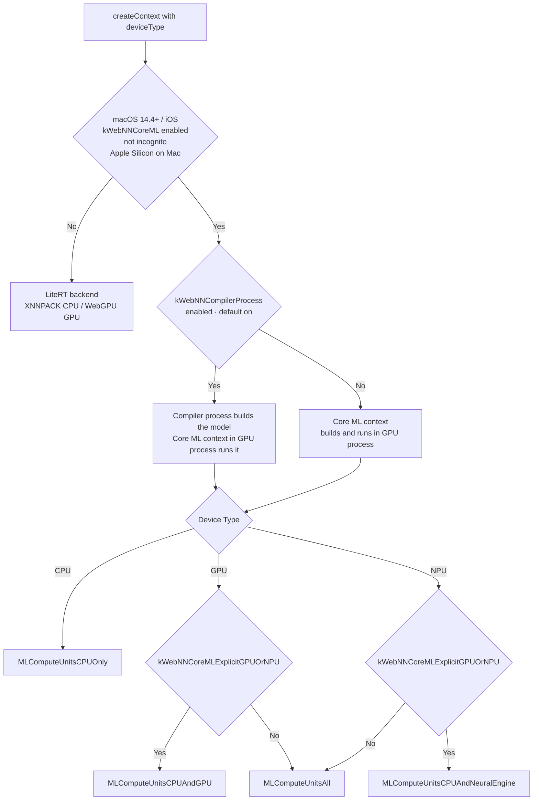

import { AndroidIcon, WindowsIcon, ChromeosIcon, MacosIcon, LinuxIcon, IosIcon } from '../../../../app/_components/icons/os.jsx'
import InfoIcon from '../../../../app/_components/icons/info.jsx'

# Browser Compatibility

## Device Selection Diagram

### Windows ML · OpenVINO Execution Provider 

This diagram shows the device selection flow for the Windows ML and OpenVINO EP.

> <InfoIcon /> This diagram applies only to Windows platforms with Intel devices, assuming no non-Intel hardware components are present.
Multiple devices can be selected in priority order.

<div className="mermaid">
```mermaid
flowchart TD
    Start[Launch browser with WebNN flag enabled]
    
    Start --> WinApp{Windows App Runtime<br/>installed}
    
    WinApp -->|Yes| WinML[Windows ML Backend]
    WinApp -->|No| TFLite[LiteRT Backend]
    
    WinML --> OVCheck{OpenVINO EP installed<br/>before launching WebNN page<br/>Intel Core Ultra Series}
    
    OVCheck -->|Yes| DevType1{Device Type}
    OVCheck -->|No| DevType2{Device Type}
    
    DevType1 -->|NPU| NPUHw{NPU hardware}
    DevType1 -->|CPU| OVCPU1[OV CPU&lt;Preferred&gt;<br/>Default CPU]
    
    NPUHw -->|Yes| OVNPU1[OV NPU<br/>Default CPU]
    NPUHw -->|No| OVGPU1[OV GPU &lt;Preferred&gt;<br/>Default CPU]
    
    DevType2 -->|GPU / NPU| DefaultGPU[Default GPU &lt;WebGPU / DirectML · Preferred&gt; <br/>Default CPU]
    DevType2 -->|CPU| DefaultCPU1[Default CPU]
    
    OVNPU1 --> SubGraphNPU{Sub-graph supported<br/>on OV NPU}
    
    SubGraphNPU -->|Yes| Compile{Graph compilation<br/>successful}
    SubGraphNPU -->|No| FallbackCPU1[Default CPU]
    
    Compile -->|Yes| FinalNPU[OV NPU]
    Compile -->|No| FallbackOVCPU[Internal fallback to OV CPU]
    
    OVCPU1 --> SubGraph1{Sub-graph supported<br/>on preferred device}
    OVGPU1 --> SubGraph1
    DefaultGPU --> SubGraph1
    
    SubGraph1 -->|Yes| Preferred[Preferred device]
    SubGraph1 -->|No| FallbackCPU2[Default CPU]
    ```
</div>

Based on each device's capabilities, the graph may be partitioned into subgraphs if certain operators are unsupported on a device. Each subgraph is then assigned to an appropriate device. If all operators are supported, the entire graph is assigned to the highest-priority selected device.

The default CPU serves as the final fallback device to ensure maximum coverage of operator sets and individual operators.

### Windows ML · Generic Execution Provider Selection

For any registered EP (not only OpenVINO), the Chromium ORT backend (`ort/environment.cc`) sorts the available EP devices, then picks devices for the requested `device` type.

1. Sort order: NPU > GPU > CPU; for GPUs, discrete before integrated; EPs whose vendor matches the hardware vendor first; WebGPU EP before DirectML EP; the default CPU EP always last.
2. `cpu`: the first CPU EP device, plus the default CPU EP.
3. `gpu`: the first GPU EP device, plus CPU fallback (the default CPU EP and a CPU EP from the same vendor). If there is no GPU, or the only GPU is a software adapter (for example Microsoft Basic Render Driver / WARP), the CPU selection is used.
4. `npu`: the first NPU EP device plus CPU fallback. If there is no NPU, or its driver is older than the EP's minimum version, the GPU selection is used.
5. Windows App Runtime and Windows 11 24H2+ are required for IHV EPs; otherwise only the built-in EPs are used.

The `--webnn-ort-ep-device=<ep_name>,<vendor_id>,<device_id>` switch overrides the selection for testing.

### Lite RT

This flow shows the device selection for the WebNN LiteRT backend, used on ChromeOS, Linux, Android, and as the fallback on Windows and Apple platforms.

<div className="mermaid">
```mermaid
flowchart TD
    Start[createContext with deviceType]
    Start --> Dev{Device Type}

    Dev -->|CPU / NPU| InProc[Renderer process<br/>in-process LiteRT]
    Dev -->|GPU| Feat{kWebNNLiteRTGpuInRenderer<br/>enabled}

    Feat -->|Yes| InProc
    Feat -->|No| GpuProc{LiteRT WebGPU accelerator<br/>context created in GPU process}

    GpuProc -->|Yes| GpuAcc[LiteRT GPU accelerator<br/>WebGPU · fp16/fp32<br/>XNNPACK CPU fallback]
    GpuProc -->|No| InProc

    InProc --> XNN[XNNPACK CPU]
```
</div>

NPU requests are not yet accelerated by LiteRT (crbug.com/454732289) and run on XNNPACK.

### Core ML

On macOS 14.4+ with Apple Silicon (non-incognito), WebNN maps the requested device type to `MLModelConfiguration.computeUnits`.

| `device` | Default | With `kWebNNCoreMLExplicitGPUOrNPU` |
| --- | --- | --- |
| `cpu` | `MLComputeUnitsCPUOnly` | `MLComputeUnitsCPUOnly` |
| `gpu` | `MLComputeUnitsAll` | `MLComputeUnitsCPUAndGPU` |
| `npu` | `MLComputeUnitsAll` | `MLComputeUnitsCPUAndNeuralEngine` |

<div className="mermaid">

</div>
