import { AndroidIcon, WindowsIcon, ChromeosIcon, MacosIcon, LinuxIcon, IosIcon } from '../../../../app/_components/icons/os.jsx'
import InfoIcon from '../../../../app/_components/icons/info.jsx'

# 浏览器兼容性

## 设备选择示意图

### Windows ML · OpenVINO Execution Provider 

下图展示了 Windows ML 和 OpenVINO EP 的设备选择流程。

> <InfoIcon /> 此图仅适用于配备 Intel 设备的 Windows 平台，并假设不存在非 Intel 硬件组件。
可以按优先级顺序选择多个设备。

<div className="mermaid">
```mermaid
flowchart TD
    Start[启用 WebNN 标志启动浏览器]
    
    Start --> WinApp{已安装 Windows App Runtime}
    
    WinApp -->|是| WinML[Windows ML Backend]
    WinApp -->|否| TFLite[LiteRT Backend]
    
    WinML --> OVCheck{启动 WebNN 页面前<br/>已安装 OpenVINO EP<br/>Intel Core Ultra 系列}
    
    OVCheck -->|是| DevType1{设备类型}
    OVCheck -->|否| DevType2{设备类型}
    
    DevType1 -->|NPU| NPUHw{NPU 硬件}
    DevType1 -->|CPU| OVCPU1[OV CPU&lt;首选&gt;<br/>默认 CPU]
    
    NPUHw -->|是| OVNPU1[OV NPU<br/>默认 CPU]
    NPUHw -->|否| OVGPU1[OV GPU &lt;首选&gt;<br/>默认 CPU]
    
    DevType2 -->|GPU / NPU| DefaultGPU[默认 GPU &lt;WebGPU / DirectML · 首选&gt; <br/>默认 CPU]
    DevType2 -->|CPU| DefaultCPU1[默认 CPU]
    
    OVNPU1 --> SubGraphNPU{子图是否被<br/>OV NPU 支持}
    
    SubGraphNPU -->|是| Compile{图编译成功}
    SubGraphNPU -->|否| FallbackCPU1[默认 CPU]
    
    Compile -->|是| FinalNPU[OV NPU]
    Compile -->|否| FallbackOVCPU[内部回退到 OV CPU]
    
    OVCPU1 --> SubGraph1{子图是否被<br/>首选设备支持}
    OVGPU1 --> SubGraph1
    DefaultGPU --> SubGraph1
    
    SubGraph1 -->|是| Preferred[首选设备]
    SubGraph1 -->|否| FallbackCPU2[默认 CPU]
    ```
</div>

根据各设备的能力，如果某些算子在设备上不受支持，计算图可能会被划分为多个子图，每个子图再被分配到合适的设备。如果所有算子都受支持，则整个计算图会被分配到优先级最高的已选设备。

默认 CPU 作为最终的回退设备，以确保对算子集合及单个算子的最大覆盖。

### Windows ML · 通用执行提供程序（EP）选择

对于任何已注册的 EP（不仅是 OpenVINO），Chromium 的 ORT 后端（`ort/environment.cc`）会先对可用的 EP 设备排序，再按请求的 `device` 类型选择设备。

1. 排序规则：NPU > GPU > CPU；GPU 中独立显卡优先于集成显卡；EP 厂商与硬件厂商一致者优先；WebGPU EP 优先于 DirectML EP；默认 CPU EP 始终排在最后。
2. `cpu`：第一个 CPU EP 设备，加上默认 CPU EP。
3. `gpu`：第一个 GPU EP 设备，加上 CPU 回退（默认 CPU EP 以及同厂商的 CPU EP）。如果没有 GPU，或唯一的 GPU 是软件适配器（例如 Microsoft Basic Render Driver / WARP），则使用 CPU 的选择结果。
4. `npu`：第一个 NPU EP 设备加上 CPU 回退。如果没有 NPU，或其驱动版本低于该 EP 要求的最低版本，则使用 GPU 的选择结果。
5. IHV EP 需要 Windows App Runtime 和 Windows 11 24H2+；否则只使用内置 EP。

可使用 `--webnn-ort-ep-device=<ep_name>,<vendor_id>,<device_id>` 开关在测试时覆盖选择结果。

### Lite RT

下图展示了 WebNN LiteRT 后端的设备选择流程。该后端用于 ChromeOS、Linux、Android，也是 Windows 和 Apple 平台上的回退方案。

<div className="mermaid">
```mermaid
flowchart TD
    Start[使用 deviceType 调用 createContext]
    Start --> Dev{设备类型}

    Dev -->|CPU / NPU| InProc[渲染进程<br/>进程内 LiteRT]
    Dev -->|GPU| Feat{是否启用<br/>kWebNNLiteRTGpuInRenderer}

    Feat -->|是| InProc
    Feat -->|否| GpuProc{GPU 进程中是否成功创建<br/>LiteRT WebGPU 加速器上下文}

    GpuProc -->|是| GpuAcc[LiteRT GPU 加速器<br/>WebGPU · fp16/fp32<br/>XNNPACK CPU 回退]
    GpuProc -->|否| InProc

    InProc --> XNN[XNNPACK CPU]
```
</div>

NPU 请求目前尚无 LiteRT 加速（crbug.com/454732289），在 XNNPACK 上运行。

### Core ML

在 macOS 14.4+ 且为 Apple Silicon（非无痕模式）时，WebNN 会把请求的设备类型映射到 `MLModelConfiguration.computeUnits`。

| `device` | 默认 | 开启 `kWebNNCoreMLExplicitGPUOrNPU` 后 |
| --- | --- | --- |
| `cpu` | `MLComputeUnitsCPUOnly` | `MLComputeUnitsCPUOnly` |
| `gpu` | `MLComputeUnitsAll` | `MLComputeUnitsCPUAndGPU` |
| `npu` | `MLComputeUnitsAll` | `MLComputeUnitsCPUAndNeuralEngine` |

```mermaid
flowchart TD
    Start[使用 deviceType 调用 createContext]
    Start --> Chk{macOS 14.4+ / iOS<br/>已启用 kWebNNCoreML<br/>非无痕模式<br/>Mac 上为 Apple Silicon}

    Chk -->|否| LiteRT[LiteRT 后端<br/>XNNPACK CPU / WebGPU GPU]
    Chk -->|是| Proc{是否启用 kWebNNCompilerProcess<br/>默认开启}

    Proc -->|是| Comp[Compiler 进程构建模型<br/>GPU 进程中的 Core ML 上下文负责运行]
    Proc -->|否| InGpu[Core ML 上下文<br/>在 GPU 进程中构建并运行]

    Comp --> Dev{设备类型}
    InGpu --> Dev

    Dev -->|CPU| CpuOnly[MLComputeUnitsCPUOnly]
    Dev -->|GPU| ExpG{kWebNNCoreMLExplicitGPUOrNPU}
    Dev -->|NPU| ExpN{kWebNNCoreMLExplicitGPUOrNPU}

    ExpG -->|是| CpuGpu[MLComputeUnitsCPUAndGPU]
    ExpG -->|否| All[MLComputeUnitsAll]
    ExpN -->|是| CpuNe[MLComputeUnitsCPUAndNeuralEngine]
    ExpN -->|否| All
```

<div className="mermaid">

</div>
